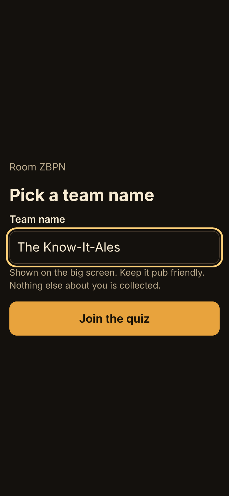
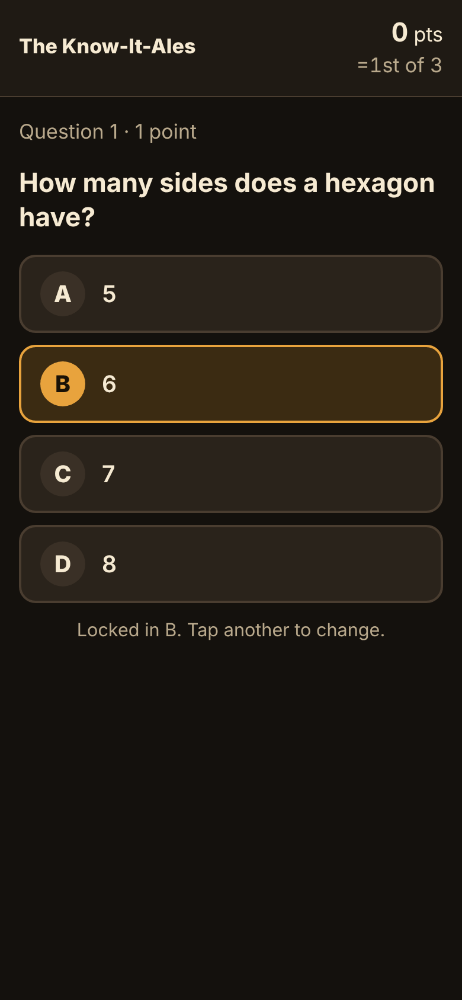
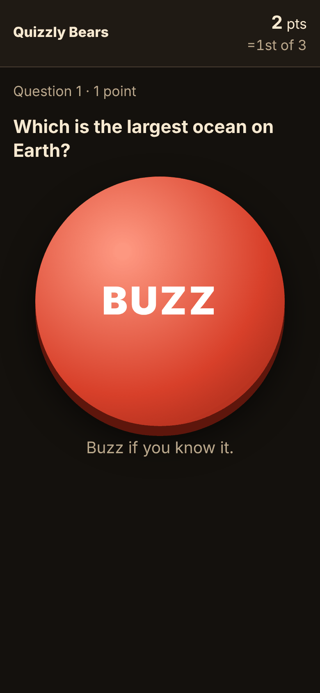
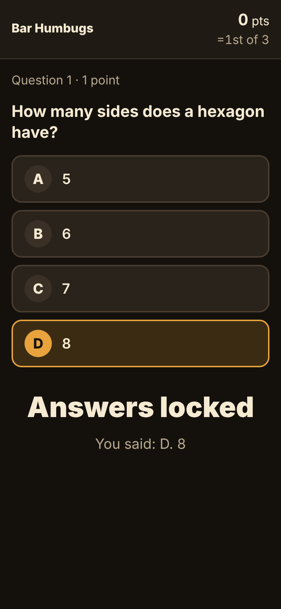
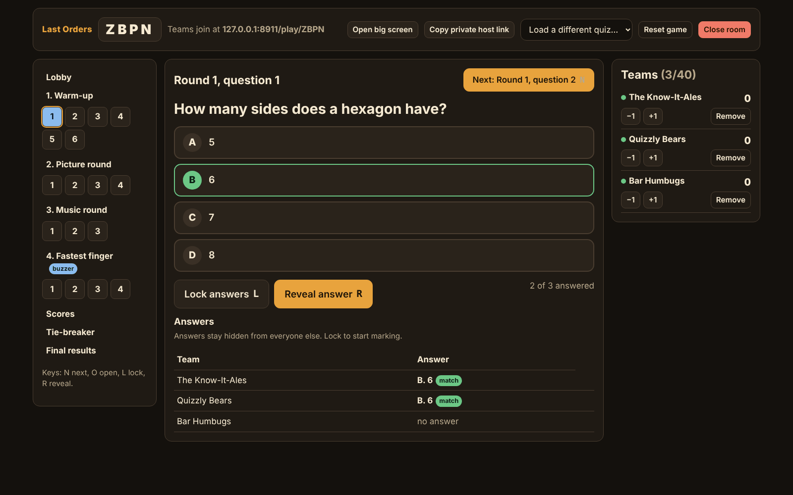
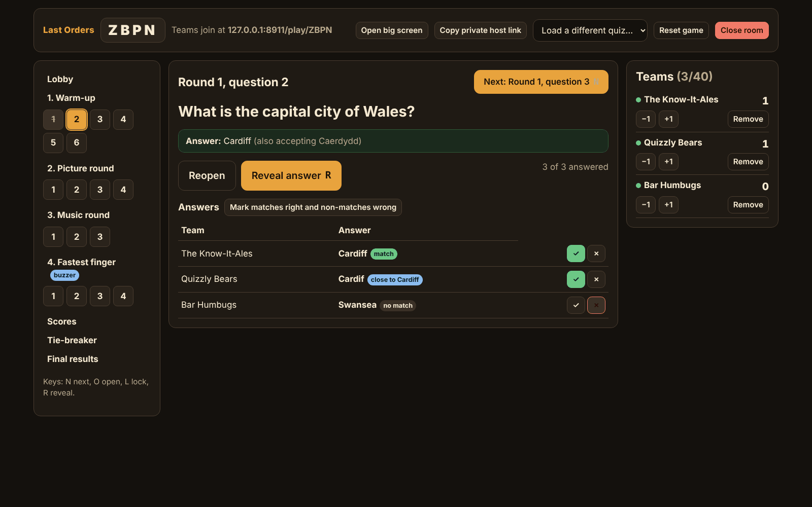
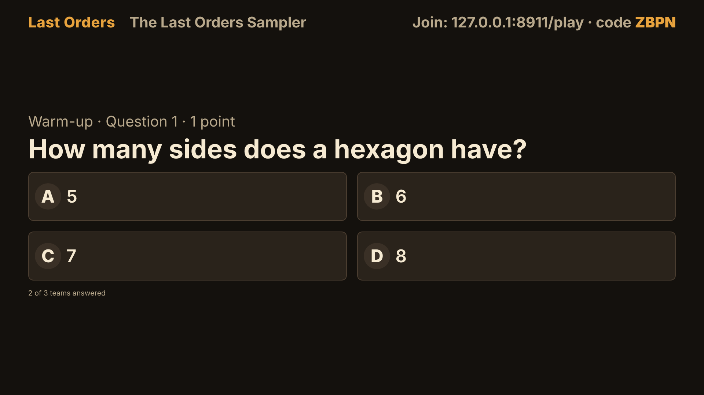
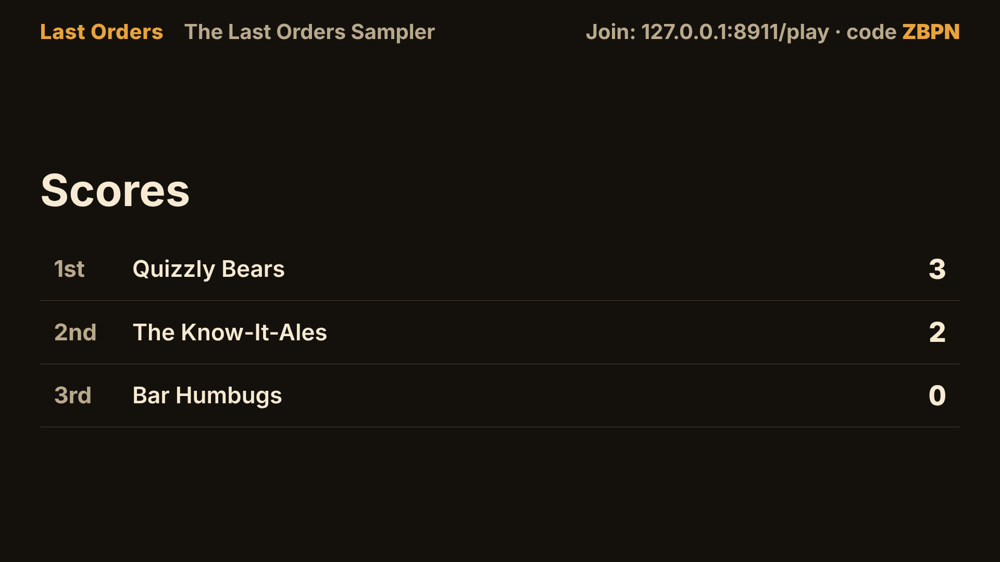

# Last Orders

[](https://github.com/banjonay1992/last-orders/actions/workflows/ci.yml)
[](LICENSE)

A pub quiz kit where every phone is the buzzer.

The quizmaster runs the night from a laptop. Teams join from their own phones by typing a four-letter room code: no accounts, no app to install, just a team nickname. A third view goes on the pub TV and shows the room code, the questions, the buzz order and the scores.

**Status:** v0.1.0, the first working version. It is live at **https://last-orders.nathancoleasi.workers.dev**, runs locally, and is covered by unit tests and tests that play games over real WebSockets inside the Workers runtime. It has not yet been used at a real quiz night; that is the first item on the [roadmap](ROADMAP.md), tracked in [#1](https://github.com/banjonay1992/last-orders/issues/1).

## Screenshots

These were captured from `wrangler dev` while a script played the sample quiz with three invented teams on phone-sized screens.

| Joining | Answering | Buzzer | Answers locked |
| --- | --- | --- | --- |
|  |  |  |  |

**Host console**, mid-question, with answers arriving and fuzzy marking hints for free text:





**Big screen** for the pub TV, showing the question and then the scores:





More in [docs/screenshots](docs/screenshots): the [lobby with its QR code](docs/screenshots/screen-lobby.png), the [buzz order on the big screen](docs/screenshots/screen-buzzer.png) and [on the host console](docs/screenshots/host-buzzer.png), a [phone after buzzing first](docs/screenshots/team-buzzed.png) and the [quiz editor](docs/screenshots/editor.png).

## What it does

- **Three views.** A host console for the laptop, a mobile-first team view for phones and a big-screen view for the TV.
- **Question rounds.** Multiple choice and free-text questions, picture questions (shown on the TV and on phones) and music questions, where the host plays the clip from their own laptop through the pub speakers. Phones never receive the audio.
- **Buzzer rounds.** First to buzz answers out loud. The order is decided by when each buzz reaches the room on the server, not by anyone's phone clock. The host marks the answer right or wrong and play passes down the queue.
- **Answer locking.** Teams can change their answer while a question is open. Locking or revealing closes it. Once the answer is revealed, nothing can change it, and the question cannot be reopened.
- **Timed questions.** A question can have a time limit. The deadline is set by the server and any answer that arrives after it is refused, even if the phone's own clock disagrees.
- **Marking.** Multiple choice marks itself. For free text, exact matches (ignoring case, accents, punctuation and a leading "the") are marked right automatically, and everything else gets a hint such as "close to Shakespeare" for the host to accept or reject with one tap.
- **Jokers.** Each team can play one joker for double points on a round, before that round's first question opens. Quiz writers can switch jokers off for individual rounds.
- **Live scoreboard** with shared ranks for equal scores, and manual plus or minus adjustments for the host.
- **Tie-breaker.** A numeric closest-guess question between the tied teams. On an exact tie, the earlier guess wins.
- **Reconnection.** Each team gets a random resume token when it joins. If a phone locks, loses signal or the browser is closed, it takes its seat back automatically when it returns, with its answers and score intact.
- **Quiz editor.** Build quizzes in the browser, validate them against the same schema the server uses, and import or export them as JSON files.

## Who it's for

Landlords, quiz hosts, clubs, charity nights and anyone running a quiz for a room of people with phones. It is designed for a dim, noisy room: dark colours, large text and buttons, the main controls within thumb reach, and one-handed use on a phone.

## Built with

- [Cloudflare Workers](https://developers.cloudflare.com/workers/) and [Durable Objects](https://developers.cloudflare.com/durable-objects/), one object per room, using the WebSocket Hibernation API
- TypeScript throughout, with [zod](https://zod.dev/) validating everything that arrives from a client
- [Preact](https://preactjs.com/) and [Vite](https://vite.dev/) for the front end
- [Vitest](https://vitest.dev/) and Cloudflare's Vitest plugin for tests, including tests that run inside the Workers runtime
- [uqr](https://github.com/unjs/uqr) to draw the join QR code locally, with no third-party service

## Running it locally

You need Node.js 22 (see `.nvmrc`) and npm. Nothing else, and no Cloudflare account.

```sh
npm ci
npm run dev
```

Then open <http://localhost:8787>. `npm run dev` builds the front end, rebuilds it when you change a file, and runs the Worker and its Durable Objects locally with `wrangler dev`. Reload the page to pick up front-end changes.

To try a whole game on one computer:

1. Click **Start a new room**. This tab is now the host console.
2. Choose **Load a quiz** and pick **Sample quiz**.
3. Click **Open big screen** to open the TV view in a new tab.
4. Open `http://localhost:8787/play/CODE` (the code is shown on the host console) in one or two private windows to play as teams. To use a real phone on the same network, run `npx wrangler dev --ip 0.0.0.0` and visit your computer's local IP address on port 8787.

If you prefer hot module reloading while working on the UI, run `npx wrangler dev` in one terminal and `npm run dev:ui` in another, then open the address Vite prints. Vite forwards API and WebSocket traffic to the Worker on port 8787. If that port is taken, `npx wrangler dev --port 8790` works, but then change the proxy target in `vite.config.ts` too.

Other commands:

| Command | What it does |
| --- | --- |
| `npm test` | Runs the unit tests and the Workers runtime tests once |
| `npm run test:watch` | Runs the tests in watch mode |
| `npm run typecheck` | Type-checks the Worker, the browser code and the tests separately |
| `npm run build` | Builds the front end into `dist/client` |

## Deploy to Cloudflare

Nothing in this repository deploys automatically, and no secrets or environment variables are needed. You need a Cloudflare account; check the current Workers, Durable Objects and rate limiting limits and pricing for your plan before running a busy quiz night.

Everything the Worker needs is declared in `wrangler.jsonc`, so a deploy creates it:

| Binding | Type | What it is for |
| --- | --- | --- |
| `ROOMS` | Durable Object namespace, class `Room` | One object per room. The `v1` migration creates the class with SQLite storage. |
| `ASSETS` | Static assets from `dist/client` | The front end. |
| `CREATE_LIMITER` | Rate limiting, 10 requests per 60 seconds | Room creation per client IP. |
| `CONNECT_LIMITER` | Rate limiting, 120 requests per 60 seconds | Room lookups and WebSocket connections per client IP. |

The rate limiting `namespace_id` values (`4101` and `4102`) only need to be unique within your Cloudflare account. If your plan does not offer the rate limiting binding, delete the `ratelimits` block: the Worker then falls back to an in-memory limiter per isolate, which is weaker but still stops a single client hammering one instance.

### With Workers Builds (Git integration)

1. In the Cloudflare dashboard, go to **Workers & Pages**, choose **Create**, then **Import a repository**, and pick your fork of this repository.
2. Keep the Worker name as `last-orders`, or change `name` in `wrangler.jsonc` to match the name you choose. Workers Builds fails if the two differ.
3. Use these build settings:

   | Setting | Value |
   | --- | --- |
   | Root directory | `/` |
   | Build command | `npm run build` |
   | Deploy command | `npx wrangler deploy` |
   | Non-production branch deploy command | `npx wrangler versions upload` |
   | Build variable | `NODE_VERSION` = `22`, if the build image does not pick up `.nvmrc` |

   Dependencies are installed from `package-lock.json` before the build command runs.
4. Save and deploy. Each push to the production branch then builds the front end and runs `wrangler deploy`, which uploads the Worker, the static files and the Durable Object class, applies the `v1` migration and creates the rate limiting bindings.
5. Your address is shown on the Worker's page. To use your own domain, add a custom domain or route to the Worker.

### From your own computer

1. Log in from this folder with `npx wrangler login`.
2. Optionally change `name` in `wrangler.jsonc`. It becomes part of your `*.workers.dev` address.
3. Run `npm run deploy`, which builds the front end and runs `wrangler deploy`.

If you later rename or remove the `Room` class, add a new entry to `migrations` in `wrangler.jsonc` rather than editing the existing one. Cloudflare's [Durable Objects migrations guide](https://developers.cloudflare.com/durable-objects/reference/durable-objects-migrations/) explains how.

## Writing quizzes

Use the editor at `/editor`, or write JSON by hand. The format is documented in [docs/quiz-format.md](docs/quiz-format.md), and [quizzes/sample-quiz.json](quizzes/sample-quiz.json) is a complete example. Every question in the sample was written for this project, and the pictures and sound clips in `public/sample-media` were drawn and synthesised for it (`scripts/make-sample-audio.mjs` regenerates the clips).

Drafts made in the editor are saved in that browser's local storage and appear in the host's **Load a quiz** menu on the same device. To move a quiz to another device, export it as a file.

Pictures are referenced by URL, either `https://` or a path on your own deployment such as `/sample-media/clock.svg`. Make sure you have the right to show any image you use. Quiz files are limited to 100,000 characters, which is plenty for text but means images cannot be embedded.

## How it works

### Architecture

```
 phones ─┐
 laptop ─┼── HTTPS / WebSocket ──> Worker (src/worker/index.ts)
 TV ─────┘                           │  POST /api/rooms        create a room
                                     │  GET  /api/rooms/CODE   does it exist?
                                     │  GET  /api/rooms/CODE/ws  WebSocket
                                     │  everything else        static front end
                                     ▼
                            Durable Object "Room" (src/worker/room.ts)
                            one per room code, owns sockets and storage
                                     │
                                     ▼
                            pure game reducer (src/worker/game.ts)
                            + per-role views (src/worker/views.ts)
```

- **`src/shared`** holds code used on both sides: the quiz schema (`quiz.ts`), the message protocol (`protocol.ts`), answer matching (`fuzzy.ts`) and limits (`limits.ts`).
- **`src/worker/game.ts`** is the whole game as a pure function: `reduce(state, actor, command, now)` returns a new state or an error. It never reads the clock, generates randomness or touches storage, so the tests can play complete games in milliseconds. Scores are calculated from the record of play rather than stored, so a corrected mark or a removed team can never leave totals out of step.
- **`src/worker/views.ts`** turns the state into what each client is allowed to see. Phones never receive the correct answer before the reveal, other teams' answers, audio URLs or anyone's tokens.
- **`src/worker/room.ts`** is a thin Durable Object. It accepts WebSockets with the hibernation API, so a quiet room can be evicted from memory without disconnecting anyone. It runs each command through the reducer, saves what changed and sends every connected client a fresh view. State is stored in small keys (room details, the quiz, and one key per question), and only changed keys are written.
- **`src/client`** is the Preact front end: `views/host.tsx`, `views/team.tsx`, `views/screen.tsx`, `views/editor.tsx` and a landing page. `lib/connection.ts` is a WebSocket client that reconnects with backoff, reconnects straight away when a phone wakes up, and re-authenticates using whatever credential last worked.

A single Durable Object processes one message at a time. That is what makes the buzz order trustworthy: whichever buzz reaches the room first is first, with no race to settle.

### Protocol overview

All messages are JSON objects with a `type` field. The full definitions are in `src/shared/protocol.ts`.

A new socket must first identify itself with one of:

| Message | Who | Notes |
| --- | --- | --- |
| `auth.host` | the quizmaster | carries the host token issued when the room was created |
| `auth.screen` | the big screen | read-only; cannot send commands |
| `auth.join` | a new team | carries the team name; the reply includes a resume token |
| `auth.resume` | a returning team | carries the resume token |

The server replies with `welcome`, then sends `state` messages containing that client's view whenever anything changes, `error` messages with a code and a readable reason when a command is refused, and `kicked` or `closed` when a team is removed or the room ends.

After that, the host can send `host.loadQuiz`, `host.goto` (move between lobby, round intros, questions, scores, tie-breaker and final results), `host.open`, `host.lock`, `host.reopen`, `host.reveal`, `host.mark`, `host.acceptExact`, `host.buzzVerdict`, `host.adjust`, `host.kick`, `host.tiebreakStart`, `host.tiebreakReveal`, `host.resetGame` and `host.closeRoom`. Teams can send `team.answer`, `team.buzz`, `team.joker` and `team.tiebreak`.

Every answer and buzz names the question it is for (for example `"questionKey": "2.0"` for round 3, question 1). If the host has already moved on, the server refuses it rather than applying it to the wrong question.

Each question moves through four phases:

```
ready ──open──> open ──lock──> locked ──reveal──> revealed
                  ^              │
                  └───reopen─────┘
```

`reveal` also locks an open question. A timed question locks itself at its deadline: the room sets an alarm for that moment, and every command checks the deadline first anyway, so a late answer is refused even if the alarm has not fired yet. Moving to a different question locks the one you left.

The client sends a plain `ping` every 25 seconds, which the runtime answers with `pong` without waking the room.

## Security

- **Host control needs the host token.** Creating a room returns a four-letter room code and, separately, a 32-character random host token (24 bytes from `crypto.getRandomValues`). Only a socket that presents the token can send host commands. The room code is never accepted in its place, another room's token is refused, and the token is never sent to teams, the big screen or the room lookup route. Tests in `test/worker/room.test.ts` check each of these.
- **The token stays out of server logs.** The host's private link carries the token after `#`, which browsers do not send to the server, and the page removes it from the address bar once it has been read.
- **Rate limits per client IP.** Room creation is limited to 10 a minute, and room lookups and WebSocket connections to 120 a minute each. Refused requests get HTTP 429; a refused WebSocket is told why and closed with code 4029, and the phone retries with backoff. The connection limit is generous because a whole pub can share one Wi-Fi address and phones reconnect each time they wake up.
- **Limits per socket and per room.** Each socket may send a burst of 20 messages, refilled at 5 a second. Extra messages are dropped with a warning, and a socket that sends 60 in a row over its budget is disconnected. A room holds at most 40 teams and 250 connections, and messages over 110,000 characters are refused.
- **Everything from a client is validated** with zod before it reaches the game logic, and teams only ever receive their own view of the game.

## Privacy

- The only information a team gives is a nickname. Nobody signs in.
- A room stores team nicknames, their answers and scores, and random tokens. This lives in the room's Durable Object storage so that it survives the object being moved or evicted. It is deleted when the host presses **Close room**, or automatically after 12 hours without activity.
- Phones keep a random resume token in local storage so they can rejoin. The editor keeps quiz drafts in local storage on the device where they were written. Neither is sent anywhere else.
- There are no analytics, no tracking, no third-party scripts, fonts or QR services, and no cookies. The pages send a restrictive Content Security Policy and `Referrer-Policy: no-referrer`.
- Cloudflare, as the host, processes requests and may keep its own operational logs. Workers observability is switched off in `wrangler.jsonc`.

## Accessibility

The team view uses large buttons (at least 56 pixels tall for main actions), keeps the main controls at the bottom of the screen, announces changes through live regions, marks selected answers with `aria-pressed` as well as colour, and respects reduced-motion settings. The buzzer fires on touch-down for speed but also works with keyboards and screen readers. The host console has keyboard shortcuts: N for next, O to open, L to lock and R to reveal.

## Limitations

- The front end has been checked by type-checking, building and the scripted game used for the screenshots, and the server by automated tests over real WebSockets, but there are no automated browser tests in CI yet ([#2](https://github.com/banjonay1992/last-orders/issues/2)).
- Rate limits count per client IP and, with the Cloudflare binding, per Cloudflare location, so they slow abuse down rather than stop a determined, distributed attacker. Add Cloudflare WAF rules in front of a busy public deployment if you need more.
- Room codes are four letters from a 20-letter alphabet (160,000 codes). That is fine for a pub but not a secret: anyone with the code can watch the big screen view or join as a team. The host controls are protected by a separate long random token.
- Buzz order is the order buzzes reach the room. A team on a slow mobile connection is at a small disadvantage, as it would be with any networked buzzer. There is no latency compensation.
- Each team plays from one phone. A second phone cannot yet join an existing team, and there is no captain or voting.
- A room holds up to 40 teams and 250 connections. Quizzes are limited to 12 rounds and 120 questions.
- Free-text matching is a suggestion only. It knows nothing about synonyms, and the host makes the final call on anything that is not an exact match.
- Audio is played by the host. Teams in another room or online will not hear it.

## Licence

MIT. See [LICENSE](LICENSE).
